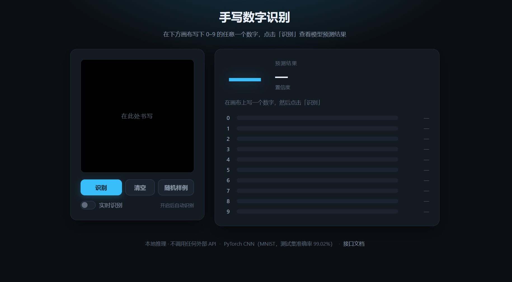
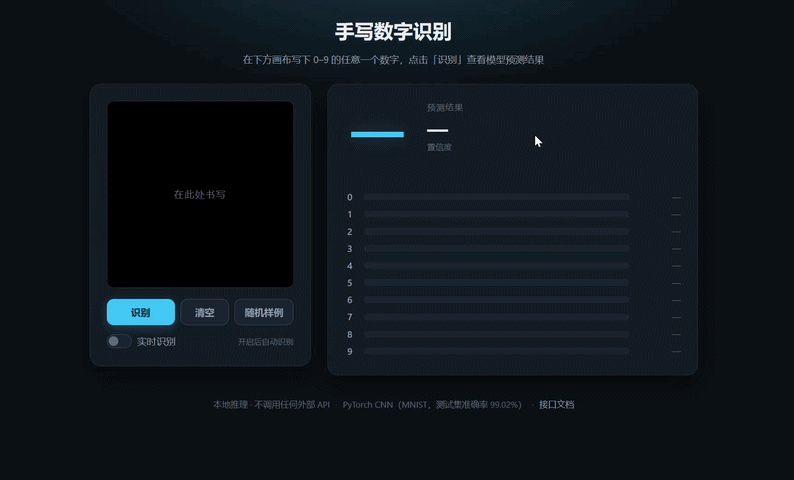
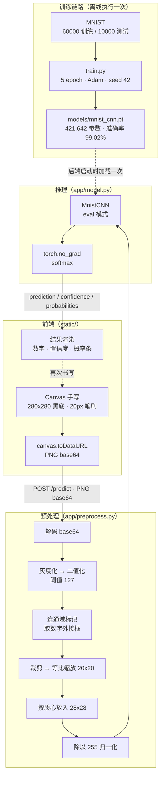

# 手写数字识别系统

> **一句话介绍**：在浏览器 Canvas 上手写 0–9 的单个数字，由本地训练的 PyTorch CNN 实时识别，返回预测数字、置信度与 10 类完整概率分布。
>
> **一句话技术栈**：Python 3.13 + PyTorch（CPU 推理）+ FastAPI + 原生 HTML/CSS/JS Canvas，pip 管理依赖，Docker 一条命令部署。
>
> **一句话亮点**：全流程本地推理、不调用任何外部云 API；测试集准确率 **99.02%**，并附真实手写场景的边界情况测试数据（写歪、写小、连笔、粗笔画）。







---

## 目录

- [项目介绍](#项目介绍)
- [系统架构](#系统架构)
- [技术栈](#技术栈)
- [目录结构](#目录结构)
- [安装](#安装)
- [训练模型](#训练模型)
- [启动服务](#启动服务)
- [访问页面](#访问页面)
- [接口说明](#接口说明)
- [接口示例](#接口示例)
- [模型指标](#模型指标)
- [边界测试](#边界测试)
- [测试](#测试)
- [Docker 部署](#docker-部署)
- [云平台部署](#云平台部署)
- [常见问题](#常见问题)
- [后续优化](#后续优化)
- [已知局限](#已知局限)

---

## 项目介绍

**做的是什么**

用户在前端黑色画布上用鼠标、触摸或触控笔书写一个数字，点击「识别」按钮后，
前端把画布的**原始 PNG** 以 base64 形式提交给后端；后端统一做 MNIST 风格预处理，
再送入本地训练好的卷积神经网络推理，返回预测结果。

**为什么这么设计**

| 设计点 | 原因 |
| --- | --- |
| 前端只传**原始 PNG**，不做任何图像处理 | 预处理逻辑集中在一处（`app/preprocess.py`），避免前后端各写一份导致算法漂移、线上效果与训练分布不符 |
| 后端预处理严格对齐 MNIST 分布 | 灰度化 → 二值化 → 裁剪数字外接框 → 等比缩放至 20×20 → 按**质心**放入 28×28 → `/255` 归一化。Canvas 与 MNIST 同为黑底白字，**不需要反色**（详见[常见问题 10](#常见问题)） |
| 识别由用户显式触发 | 默认点击「识别」按钮识别，避免书写过程中的残笔、抖动被当成最终结果。需要连续观察时再打开「实时识别」开关，按固定间隔自动识别 |
| 模型在启动时加载一次并常驻内存 | 避免每个请求都读盘；加载后显式 `model.eval()`，否则 Dropout 在推理时仍生效、同一张图每次结果都不一样 |
| 分层结构预留多数字扩展 | 预处理层已按「返回连通域外接框列表并按 x 排序」设计，单数字取列表首项，未来升级多数字识别无需改动模型与接口结构 |
| 概率柱状图对非零概率设**视觉最小宽度** | 模型自信时最高那根接近 100%、其余 9 根不到 1px，看不出"不是零"。这是纯视觉处理，**不修改任何数据** |

**当前范围**：仅支持单个数字（0–9）。多数字识别的扩展方案见[后续优化](#后续优化)。

---

## 系统架构



Canvas 与 MNIST 同为黑底白字，因此预处理不做反色；`models/mnist_cnn.pt` 由 `train.py` 离线产出，后端在启动时加载一次。

---

## 技术栈

| 层次 | 选型 |
| --- | --- |
| 语言 | Python 3.11+（3.13.6） |
| 深度学习 | PyTorch、torchvision |
| 后端 | FastAPI、Uvicorn、pydantic |
| 图像处理 | Pillow、NumPy、SciPy（连通域标记） |
| 训练分析 | scikit-learn（分类报告、混淆矩阵）、matplotlib（训练曲线） |
| 前端 | 原生 HTML / CSS / JavaScript Canvas（**无框架、无 CDN、无外部字体**） |
| 数据集 | MNIST |
| 包管理 | pip + requirements.txt |
| 测试 | pytest、httpx |
| 部署 | Docker |

### 环境版本

各依赖的实际版本：

| 包 | 版本 |
| --- | --- |
| Python | 3.13.6 |
| torch | 2.14.0+cpu |
| torchvision | 0.29.0+cpu |
| numpy | 2.4.6 |
| pillow | 12.2.0 |
| scipy | 1.18.0 |
| fastapi | 0.141.1 |
| uvicorn | 0.54.0 |
| pydantic | 2.13.5 |
| matplotlib | 3.11.0 |
| scikit-learn | 1.9.1 |
| pytest | 9.1.1（开发依赖） |
| httpx | 0.28.1（开发依赖） |

> `requirements.txt` 用的是 `>=` 兼容下限而非精确锁定，其他机器上装到的版本可能更高。
> 训练与推理全部在 CPU 上完成（无 CUDA 亦可）。

---

## 目录结构

```text
D:\PythonProject
├── train.py                  # MNIST 训练脚本：训练、评估、保存模型与报告
├── app/                      # 后端包
│   ├── __init__.py
│   ├── main.py               # FastAPI 入口：CORS、静态托管、/predict、/sample
│   ├── model.py              # CNN 网络结构定义（训练与推理共用）
│   ├── preprocess.py         # MNIST 风格预处理（前后端唯一处理入口）
│   └── schemas.py            # pydantic 请求/响应模型
├── static/                   # 前端静态资源
│   ├── index.html            # 手写页面
│   ├── app.js                # 画布绘制、base64 编码、请求与结果渲染
│   └── style.css             # 暗色主题（CSS 变量组织）
├── assets/                   # README 引用的截图与 GIF
├── models/                   # 模型权重（由 train.py 生成，不入库）
│   └── mnist_cnn.pt
├── reports/                  # 训练与测试产出（不入库）
│   ├── training_curve.png
│   ├── confusion_matrix.png
│   ├── classification_report.txt
│   ├── test_predictions.png
│   └── edge_cases.png        # 边界情况对照图
├── data/                     # MNIST 下载缓存（不入库）
├── tests/                    # pytest 测试
│   ├── test_api.py           # 接口测试
│   ├── test_preprocess.py    # 预处理单元测试
│   └── test_model.py         # 模型与权重测试
├── tools/                    # 开发辅助脚本（不参与运行）
│   └── edge_cases.py         # 边界情况探测：写歪/写小/写满/连笔等
├── conftest.py               # 让 pytest 把项目根目录加入 sys.path
├── requirements.txt          # 主依赖
├── requirements-dev.txt      # 开发/测试依赖（可选）
├── Dockerfile
├── .dockerignore
├── .gitignore
└── README.md
```

---

## 安装

### 1. 创建并激活虚拟环境

Windows（PyCharm 终端 / PowerShell / Git Bash）：

```bash
python -m venv .venv
.venv\Scripts\activate
```

macOS / Linux：

```bash
python -m venv .venv
source .venv/bin/activate
```

### 2. 安装依赖

只跑训练和服务：

```bash
pip install -r requirements.txt
```

需要运行测试时改用开发依赖（已包含主依赖）：

```bash
pip install -r requirements-dev.txt
```

---

## 训练模型

```bash
python train.py
```

脚本会：

1. 自动下载 MNIST 到 `./data/`（首次运行需要联网，4 个文件共约 12 MB）；
2. 在训练集上训练 CNN，每个 epoch 后在**测试集**上评估，保存测试准确率最高的那一轮权重
   （详见[已知局限 6](#已知局限)）；
3. 训练结束后重新载入最佳权重，输出测试准确率、分类报告与混淆矩阵。

**预期输出**：

```text
==================================================================
MNIST CNN training
==================================================================
  device        : cpu
  epochs        : 5
  batch_size    : 64
  lr            : 0.001 (Adam)
  seed          : 42
  chinese_font  : Microsoft YaHei
==================================================================
  train samples : 60,000
  test  samples : 10,000
  model params  : 421,642
------------------------------------------------------------------
[Epoch 1/5] train_loss=0.2446  train_acc= 92.41%  |  test_loss=0.0678  test_acc= 97.66%
[Epoch 2/5] train_loss=0.0774  train_acc= 97.60%  |  test_loss=0.0423  test_acc= 98.57%
[Epoch 3/5] train_loss=0.0552  train_acc= 98.29%  |  test_loss=0.0414  test_acc= 98.66%
[Epoch 4/5] train_loss=0.0426  train_acc= 98.65%  |  test_loss=0.0382  test_acc= 98.68%
[Epoch 5/5] train_loss=0.0356  train_acc= 98.87%  |  test_loss=0.0291  test_acc= 99.02%
------------------------------------------------------------------
  test accuracy : 99.02%
  [OK] target accuracy 98% reached.
==================================================================
```

产出文件：

| 文件 | 内容 |
| --- | --- |
| `models/mnist_cnn.pt` | 最佳模型权重（1.69 MB） |
| `reports/training_curve.png` | 训练/测试的 loss 与 accuracy 双子图 |
| `reports/confusion_matrix.png` | 带数值标注的混淆矩阵 |
| `reports/classification_report.txt` | precision / recall / f1-score |
| `reports/test_predictions.png` | 4×5=20 张测试样例的预测结果 |

训练耗时与各项指标见[模型指标](#模型指标)；训练超参集中在 `train.py` 顶部常量中，便于调整。

---

## 启动服务

在项目根目录执行：

```bash
uvicorn app.main:app --reload
```

**预期输出**：

```text
==================================================================
Starting handwritten digit recognition service
  device     : cpu
  model path : D:\PythonProject\models\mnist_cnn.pt
  model      : loaded OK (eval mode)
  mnist data : ready
==================================================================
INFO:     Uvicorn running on http://127.0.0.1:8000 (Press Ctrl+C to quit)
```

模型在启动时加载一次并常驻内存。若 `models/mnist_cnn.pt` 不存在，服务仍会正常启动，
`/predict` 返回 503 并说明原因（见[接口说明](#接口说明)）。

---

## 访问页面

| 地址 | 说明 |
| --- | --- |
| <http://127.0.0.1:8000/> | 前端手写页面 |
| <http://127.0.0.1:8000/docs> | Swagger UI 交互式接口文档，可直接试 `POST /predict` |
| <http://127.0.0.1:8000/health> | 健康检查，确认模型是否已加载 |
| <http://127.0.0.1:8000/sample> | 随机取一张带标签的 MNIST 测试图 |

页面布局：左侧是黑色画布（笔刷 20px，支持鼠标 / 触摸 / 触控笔），
右侧是结果区（大号预测数字、置信度百分比、10 个数字的概率柱状图）。

操作区有四个控件：

| 控件 | 行为 |
| --- | --- |
| **识别** | 把画布导出成 PNG base64，`POST /predict`，渲染结果 |
| **清空** | 重置画布与结果区，重新显示书写提示 |
| **随机样例** | `GET /sample` 取一张带真实标签的 MNIST 图贴到画布上并**自动识别**，状态行显示是否与真实标签一致 |
| **实时识别**（开关，默认关闭） | 打开后每 900ms 自动识别一次画布内容，无需点按钮；关闭后与手动模式完全一致 |

**实时识别模式的细节**：开关只控制触发方式，结果仍显示在同一个结果区，手动「识别」按钮同时可用。
空画布会被**静默跳过**（不提示、不发请求）；识别结果与上一次完全相同时不重渲染，
所以静止书写时画面保持安静、不会反复播放动画。开关状态不持久化，刷新页面后回到关闭状态。
间隔常量是 `static/app.js` 顶部的 `REALTIME_INTERVAL_MS`。

微动效：预测数字淡入缩放、置信度从 0 滚动到目标值、柱状图宽度从 0 平滑过渡，
概率最高的那一根加粗高亮。已适配 `prefers-reduced-motion`（系统开启"减少动态效果"时自动关闭动画）。

概率条形对**非零**概率设了 3px 的视觉下限（`static/app.js` 的 `MIN_BAR_WIDTH`），
避免模型自信时其余 9 根宽度不足 1px 而看不出来；右侧百分比文字始终显示真实值。

响应式：宽屏为左右两栏，窄屏（≤760px）自动堆叠为单栏，手机上可正常书写。

---

## 接口说明

### `POST /predict` — 识别手写数字

请求体：

```json
{
  "image": "data:image/png;base64,iVBORw0KGgoAAAANSUhEUgAA..."
}
```

`image` 为前端 Canvas 导出的 PNG 的 base64 字符串。允许带 `data:image/png;base64,` 前缀，
后端会自动剥离；直接传纯 base64 也可以。

响应体（示例：MNIST 测试集第 0 张，真实标签 7）：

```json
{
  "prediction": 7,
  "confidence": 0.999998,
  "probabilities": [0.0, 0.0, 0.000001, 0.000002, 0.0, 0.0, 0.0, 0.999998, 0.0, 0.0]
}
```

| 字段 | 类型 | 说明 |
| --- | --- | --- |
| `prediction` | int | 预测的数字（0–9） |
| `confidence` | float | 该数字的置信度，即 softmax 概率，范围 0–1 |
| `probabilities` | float[10] | 下标即数字 0–9，元素为该类概率，总和为 1 |

> 概率保留 6 位小数，四舍五入后总和可能偏差不超过 1e-5，属预期行为。

错误响应（统一为 `{"detail": "..."}`）：

| 状态码 | 触发条件 | `detail` |
| --- | --- | --- |
| 400 | 空画布 / 未检测到笔画 / 整幅纯白 | `未检测到手写数字，请先写一个数字。` |
| 400 | base64 非法、内容不是图片、图片过大 | `图片解析失败：<具体原因>` |
| 422 | 请求体缺 `image` 字段（pydantic 拦截） | 字段校验错误详情 |
| 503 | 模型未训练，`models/mnist_cnn.pt` 不存在 | `模型文件 models/mnist_cnn.pt 不存在，请先在项目根目录运行：python train.py` |

### `GET /sample` — 随机取一张带标签的 MNIST 测试图

无参数。每次调用随机返回一张 MNIST 测试图片及其真实标签，供前端「随机样例」按钮使用。

```json
{
  "image": "data:image/png;base64,iVBORw0KGgoAAAANSUhEUgAA...",
  "label": 7
}
```

| 字段 | 类型 | 说明 |
| --- | --- | --- |
| `image` | string | 28×28 灰度图**最近邻放大到 280×280** 后的 base64 PNG，带 data URL 前缀。最近邻不产生模糊过渡像素，前端贴到画布上边缘锐利 |
| `label` | int | 该图片的真实标签（0–9） |

| 状态码 | 触发条件 | `detail` |
| --- | --- | --- |
| 503 | 本地缺少 MNIST 数据 | `本地未找到 MNIST 数据，请先运行 python train.py` |

> 该接口只做**本地读取**（`download=False`），绝不在请求里触发下载——
> 否则用户点一次按钮可能卡住几分钟。数据下载由 `train.py` 负责。
> MNIST 测试集在首次调用时懒加载并缓存，之后不再重复读盘。

### `GET /health` — 健康检查

```json
{
  "status": "ok",
  "model_loaded": true,
  "model_path": "models/mnist_cnn.pt",
  "device": "cpu",
  "detail": null
}
```

模型未加载时 `status` 为 `degraded`，并在 `detail` 中说明原因。

### 全部路由

| 方法 | 路径 | 说明 |
| --- | --- | --- |
| `GET` | `/` | 前端页面 `static/index.html`；该文件缺失时返回说明性占位页 |
| `GET` | `/health` | 健康检查 |
| `GET` | `/sample` | 随机取一张带标签的 MNIST 测试图 |
| `POST` | `/predict` | 识别手写数字 |
| `GET` | `/docs` | Swagger UI 交互式文档 |
| `GET` | `/openapi.json` | OpenAPI 规范 |
| `GET` | `/static/*` | `static/` 目录下的静态资源 |

---

## 接口示例

### cURL

```bash
# 1) 把一张 PNG 转成 base64 并提交
base64 -w 0 digit.png > digit.b64
curl -X POST http://127.0.0.1:8000/predict \
  -H "Content-Type: application/json" \
  -d "{\"image\":\"data:image/png;base64,$(cat digit.b64)\"}"

# 2) 健康检查
curl http://127.0.0.1:8000/health
```

### Python（用 MNIST 测试集里的真实图片）

```python
import base64, io, json, urllib.request
from torchvision import datasets

# 取一张真实 MNIST 图片并编码成 base64 PNG（等价于前端 canvas.toDataURL() 的输出）
image, label = datasets.MNIST(root="data", train=False, download=False)[0]
buffer = io.BytesIO()
image.save(buffer, format="PNG")
payload = "data:image/png;base64," + base64.b64encode(buffer.getvalue()).decode()

request = urllib.request.Request(
    "http://127.0.0.1:8000/predict",
    data=json.dumps({"image": payload}).encode(),
    headers={"Content-Type": "application/json"},
)
with urllib.request.urlopen(request) as response:
    result = json.loads(response.read())

print("真实标签 :", label)
print("预测     :", result["prediction"])
print("置信度   :", result["confidence"])
```

输出：

```text
真实标签 : 7
预测     : 7
置信度   : 0.999998
```

### 前端（源码见 `static/app.js`）

```javascript
const dataUrl = canvas.toDataURL("image/png");   // 直接提交原始画布，不做任何前端处理
const response = await fetch("/predict", {
  method: "POST",
  headers: { "Content-Type": "application/json" },
  body: JSON.stringify({ image: dataUrl }),
});
const { prediction, confidence, probabilities } = await response.json();
```

---

## 模型指标

`python train.py` 的运行结果（seed=42 固定）：

| 指标 | 数值 |
| --- | --- |
| 网络结构 | Conv(1→32)-Pool-Conv(32→64)-Pool-FC(3136→128)-Dropout(0.25)-FC(128→10) |
| 参数量 | 421,642（约 0.42M） |
| 训练轮数 | 5 |
| 优化器 | Adam，lr = 1e-3，batch_size = 64 |
| 最佳轮次 | 第 5 轮 |
| **测试集准确率** | **99.02%**（10000 张错 98 张） |
| 测试集 loss | 0.0291 |
| macro avg F1 | 0.9901 |
| 训练耗时 | 约 84 秒（CPU，24 逻辑核 / torch 12 线程，不含数据下载） |

各类别表现（完整报告见 `reports/classification_report.txt`）：

| 数字 | precision | recall | f1-score | support |
| --- | --- | --- | --- | --- |
| 0 | 0.9929 | 0.9929 | 0.9929 | 980 |
| 1 | 0.9947 | 0.9956 | 0.9952 | 1135 |
| 2 | 0.9817 | 0.9903 | 0.9860 | 1032 |
| 3 | 0.9931 | 0.9950 | 0.9941 | 1010 |
| 4 | 0.9949 | 0.9908 | 0.9929 | 982 |
| 5 | 0.9866 | 0.9922 | 0.9894 | 892 |
| 6 | 0.9906 | 0.9864 | 0.9885 | 958 |
| 7 | 0.9941 | 0.9825 | 0.9883 | 1028 |
| 8 | 0.9847 | 0.9897 | 0.9872 | 974 |
| 9 | 0.9881 | 0.9861 | 0.9871 | 1009 |
| **macro avg** | **0.9901** | **0.9902** | **0.9901** | 10000 |

**错误分析**：最主要的混淆是真实 7 被预测成 2（10 张），其次是 4→9 与 7→9（各 6 张）。
都是笔画走向接近的类别，属 MNIST 上典型的难点。数字 7 的 recall 最低（0.9825），
与它训练样本的书写多样性大有关。

训练曲线与混淆矩阵见 `reports/`：

- `reports/training_curve.png` — 左 loss、右 accuracy，train/test 对比
- `reports/confusion_matrix.png` — 带数值标注
- `reports/test_predictions.png` — 20 张预测样例（绿=正确，红=错误）

---

## 边界测试

模型在 MNIST 测试集上 99.02% 的准确率，**不代表真实使用体验**——用户会写歪、写小、
只写一条竖线当「1」、把「4」写得不闭合。这些情况 MNIST 测试集覆盖不到。

`tools/edge_cases.py` 按 `static/app.js` 的**同一套画布参数**（280×280 黑底、白色圆头
笔刷 20px、PNG→base64→`POST /predict`）合成各种极端输入并逐一提交，产出对照图
`reports/edge_cases.png`。

```bash
python tools/edge_cases.py
```

### 几何与笔画极端情况（共 16 项，输入完整的 15 项中通过 14 项）

| 用例 | 预测 / 真实 | 置信度 | 结论 |
| --- | --- | --- | --- |
| 偏左 / 偏右 / 偏上 / 偏下（偏移 60px） | 7 / 7 | 100.00% | ✅ 位置不影响 |
| 写小 70px（占画布 1/4） | 7 / 7 | 99.91% | ✅ |
| 写小 90px | 7 / 7 | 99.98% | ✅ |
| 中号 130px | 7 / 7 | 100.00% | ✅ |
| 写满 210px（占画布 3/4） | 7 / 7 | 100.00% | ✅ |
| 角落 + 大片留白 | 7 / 7 | 99.98% | ✅ 裁剪定位正确 |
| 粗笔画 34px（反复描） | 7 / 7 | 100.00% | ✅ |
| 细笔画 8px | 7 / 7 | 100.00% | ✅ 二值化后信息量足够 |
| 连笔：1 单竖线 | 1 / 1 | 100.00% | ✅ |
| 连笔：7 无横杠 | 7 / 7 | 100.00% | ✅ |
| 连笔：4 开口不闭合 | 4 / 4 | 100.00% | ✅ |

### 最小可识别字高

**最小可识别字高约 60px**（约占画布 1/5）。更小也能识别，但准确率会随字高下降。
下表的每一行都是 **200 张真实样本**（10 类 × 每类 20 张）的结果：

| 字高 | 占画布比例 | 识别率 | 平均置信度 |
| --- | --- | --- | --- |
| 50px | 约 1/6 | 46.0% | 80.3% |
| 55px | 约 1/5 | 65.5% | — |
| **60px** | 约 1/5 | **71.0%** | — |
| 70px | 1/4 | 85.5% | — |
| 100px | 约 1/3 | 97.5% | 96.4% |

**实践建议**：把数字写到画布高度的一半以上（≥140px），识别率与 MNIST 测试集持平。
只在画布一角写一个小数字，是所有识别方案的共同弱点，本项目也不例外。

字高受限的原因是**笔刷宽度与字号的比例**：笔刷固定 20px，字高小于约 60px 时笔画会粘连糊成
一团，而不是模型或预处理有缺陷。若要支持小字，应在前端按书写尺寸动态调细笔刷，
而不是改 `preprocess.py` 的参数。

### 置信度的可靠性

50px 字高下，**108 个错误预测里有 24 个（22%）置信度仍然 ≥ 0.9**，最高到 100%。
所以「低置信度 = 模型不确定」在这个模型上只是**弱成立**，不能当作可靠的拒识依据。

可复现的整体趋势是有的：小字场景平均置信度（0.771）明显低于正常字号（0.968），
差距约 20 个百分点。这一点已写成回归测试
（`test_small_digit_confidence_is_lower_on_average`），但断言的是**平均值**而非单张图。

### 超出画布被截断

把数字写得过大、顶到画布边缘时，Canvas 记不到画布之外的内容，上沿会被切掉。
例如 210px 的「7」中心放在 y=68 时，顶横被切掉只剩一条斜笔，模型判成 **1**（置信度 100%）。

这**恰恰说明模型行为是正确**的：一条斜笔在 MNIST 分布里就是 1。
问题出在输入信息已经不完整，属于 garbage in garbage out，不是模型缺陷。

### 预处理参数

`BINARY_THRESHOLD`（127）、`MIN_DIGIT_AREA`（20）、`INVERT_INPUT`（False）均未调整：
失败项的原因都与这三个参数无关。没有证据支持改动核心预处理，改了反而会引入回归风险。

---

## 测试

```bash
# 全部测试
pytest tests/ -v

# 单独跑某一类
pytest tests/test_api.py -v
pytest tests/test_preprocess.py -v
pytest tests/test_model.py -v
```

共 **65 项，约 4.4 秒**（`fastapi.testclient.TestClient`，不需要启动 uvicorn）：

| 文件 | 数量 | 覆盖内容 |
| --- | --- | --- |
| `tests/test_api.py` | 20 | 接口契约与端到端链路 |
| `tests/test_preprocess.py` | 30 | 预处理的纯函数行为 |
| `tests/test_model.py` | 15 | 网络结构与权重加载 |

**接口测试**（`test_api.py`）重点项：

| 用例 | 验证内容 |
| --- | --- |
| `test_blank_canvas_returns_400` | 全黑空画布 → 400，`detail` 含「未检测到」 |
| `test_all_white_image_returns_400` | 整幅纯白图 → 400（不被硬猜成某个数字） |
| `test_invalid_image_returns_4xx` | 乱码 base64 / 非图片 / 空串 → 4xx 而非 500 |
| `test_real_mnist_image_predicted_correctly` | 真实图片 → 200 且 `prediction == 标签` |
| `test_mnist_batch_accuracy` | 前 20 张真实图片正确率 ≥ 90% |
| `test_response_schema_is_valid` | 概率 10 个、和为 1、`confidence` 等于最大值 |
| `test_small_digit_still_returns_usable_prediction` | 小字场景**仍返回合法预测值**（不因不确定而拒答） |
| `test_small_digit_confidence_is_lower_on_average` | 小字平均置信度显著低于正常字号 |
| `test_sample_to_predict_roundtrip` | `/sample` → `/predict` 往返结果与真实标签一致 |
| `test_openapi_schema_documents_all_endpoints` | OpenAPI 文档包含全部对外接口 |

**预处理测试**（`test_preprocess.py`）重点项：

| 用例 | 验证内容 |
| --- | --- |
| `test_binarize_marks_white_strokes_on_black_background` | **极性**：黑底白笔画被正确识别为笔画（最容易搞反的地方） |
| `test_binarize_invert_flips_polarity` | `INVERT_INPUT` 开关双向都可用 |
| `test_find_digit_boxes_is_sorted_left_to_right` | 外接框按 x 排序（多数字扩展的排序依据） |
| `test_find_digit_boxes_merges_diagonally_touching_strokes` | 斜向相接算同一连通域（8 邻域标记） |
| `test_crop_and_center_preserves_aspect_ratio` | 等比缩放不变形 |
| `test_crop_and_center_is_not_merely_bounding_box_centered` | 区分「质心对齐」与「外接框居中」 |
| `test_centroid_alignment_on_real_digits` | 5 张真实数字的质心都落在 13.5±1 |
| `test_all_ink_canvas_raises_empty_canvas_error` | `MAX_INK_RATIO` 拦截满幅笔画 |
| `test_preprocessing_is_deterministic` | 同样输入逐位相同（预处理里不能有随机性） |

**模型测试**（`test_model.py`）重点项：

| 用例 | 验证内容 |
| --- | --- |
| `test_trained_model_dropout_is_disabled` | **功能验证** eval 模式下同一输入两次前向输出完全一致 |
| `test_train_mode_does_activate_dropout` | 反向验证 train 模式下 dropout 确实生效（证明上一条有意义） |
| `test_forward_returns_logits_not_probabilities` | forward 不能内置 softmax（否则与 CrossEntropyLoss 冲突） |
| `test_save_and_load_roundtrip` | 权重保存/加载后逐位一致 |
| `test_load_model_raises_filenotfound_with_helpful_message` | 报错信息里含 `train.py` 提示 |
| `test_parameter_count_matches_readme` | 参数量与 README 一致（改结构必须同步文档） |
| `test_trained_model_gives_high_confidence_on_mnist` | 确认模型文件是训练好的权重而非随机初始化 |

> 模型文件或 MNIST 数据不存在时，相关用例会 `skip` 并说明原因，而不是整片报错。

---

## Docker 部署

### 本地构建与运行

```bash
docker build -t mnist-web .
docker run -p 8000:8000 mnist-web
```

然后浏览器打开 <http://127.0.0.1:8000/>。

### 镜像设计说明

| 决策 | 原因 |
| --- | --- |
| 基于 `python:3.13-slim` | 与开发环境一致的 Python 版本，slim 变体体积小 |
| **单独安装 CPU 版 PyTorch** | 直接从 PyPI 装 `torch` 会连带拉取数 GB 的 `nvidia-*` 依赖，本项目只做 CPU 推理，用官方 CPU 索引后镜像体积小一个数量级 |
| 先 `COPY requirements.txt` 再安装 | 利用层缓存：改业务代码重新构建时依赖层秒过 |
| 额外安装 `libgomp1` | torch / scipy / scikit-learn 依赖的 OpenMP 运行时，slim 镜像默认不带 |
| **打包含 `models/mnist_cnn.pt`** | 仅 1.69 MB，打进镜像最省事，部署时无需挂载卷 |
| **不打包 `data/`** | MNIST 约 64 MB；云端 `/sample` 因此返回 503（见下） |
| 不打包 `reports/`、`tests/`、`tools/` | 纯开发/展示材料，运行时不读 |
| `CMD` 监听 `0.0.0.0` | 只听 `127.0.0.1` 的话容器外部访问不到 |
| 内置 `HEALTHCHECK` | 用 Python 标准库发请求，不依赖 slim 里没有的 `curl` |

> 若所在网络访问不了 `download.pytorch.org`，把 Dockerfile 里那条
> `--index-url .../whl/cpu` 的安装命令删掉、改为直接装 `requirements.txt` 即可
> （镜像会大很多，但能装上）。

### 本地运行时的数据挂载（可选）

想在容器里也用「随机样例」功能，把本地的 `data/` 挂进去即可：

```bash
docker run -p 8000:8000 -v ./data:/app/data mnist-web
```

---

## 云平台部署

本项目的部署形态是「**单个 Docker 容器 + HTTP 服务 + 需要公网访问**」，
任何支持容器部署的平台都能用。下面写的是通用步骤，不绑定具体厂商。

### 部署前提

- 一台能访问公网的容器运行环境
- 项目已有可用 Dockerfile（本仓库已提供）
- 镜像需要放到某个镜像仓库（Docker Hub、GitHub Container Registry、各云厂商的镜像服务均可）

### 通用部署步骤（任何平台适用）

**1. 本地构建镜像**

```bash
docker build -t <你的镜像名>:v1 .
```

**2. 推送到镜像仓库**

```bash
docker tag <你的镜像名>:v1 <仓库地址>/<你的镜像名>:v1
docker login <仓库地址>          # 首次需要先登录
docker push <仓库地址>/<你的镜像名>:v1
```

**3. 在目标云平台创建应用 / 服务**，填写：

| 配置项 | 值 | 说明 |
| --- | --- | --- |
| 镜像地址 | 上一步 push 的地址 | |
| 容器端口 | `8000` | 本项目的 uvicorn 端口 |
| 实例数量 | `1` | 演示足够；本项目无状态，需要时可水平扩容 |
| CPU / 内存 | 0.5 核 / 512 MB 起步 | CPU 推理很轻量，单张图片毫秒级 |
| 外部访问 | 启用 | 大多数平台会自动分配域名 + HTTPS |

**4. 等待平台部署完成**，浏览器打开分配到的公网地址即可访问。

**5. 任何联网设备**（手机、其他电脑）打开该地址都能用，不需要与服务器在同一网络。

### 可选平台举例

以下只是例子，**不是唯一方案**，选择任意支持容器部署的平台都可以：

- **Sealos Cloud**：国内访问快，有免费额度，操作路径短。
- **Railway / Render**：海外平台，部署简单，免费额度有限。
- **Fly.io**：海外平台，支持全球边缘部署。
- **阿里云 / 腾讯云 容器服务**：国内企业常用，需自行配置域名与证书。
- **自建服务器 + Docker**：完全可控，需要自己处理公网 IP、HTTPS、反向代理。

### 部署注意事项

- **`/sample` 接口在云端会返回 503**。该接口依赖本地 MNIST 数据（`data/`），
  而镜像出于体积考虑没有打包 `data/`，这是预期行为。
  **云端用户请手写数字**，「随机样例」按钮仅本地可用。
  （如果确实需要云端也能用，把 `.dockerignore` 里的 `data/` 去掉再重新构建即可，镜像会大约 64 MB。）
- **模型文件已打进镜像**，无需额外挂载卷。
- **端口映射**：若平台要求必须以 80 或其他端口对外，在平台侧把容器端口 8000 映射过去即可，
  容器内的应用不用改。
- **生产环境**：如需长期运行，建议加反向代理（Nginx / Caddy）与进程守护。
  本项目定位是演示项目，直接用平台托管已经足够。

---

## 常见问题

<details>
<summary><b>1. <code>uvicorn</code> 报错说找不到模型文件？</b></summary>

在项目根目录执行 `python train.py` 生成 `models/mnist_cnn.pt`。服务不会自动训练。
</details>

<details>
<summary><b>2. 首次训练卡在下载 MNIST？</b></summary>

MNIST 四个压缩文件共约 12 MB，会下载到 `./data/MNIST/raw/`。
若下载缓慢，可手动下载 `train-images-idx3-ubyte.gz` 等 4 个文件放进该目录后重跑。
目录里已有 8 个文件（4 个 `.gz` + 4 个解压后文件）时不会重复下载。
</details>

<details>
<summary><b>3. matplotlib 图表中文变方块？</b></summary>

`train.py` 内置了 `setup_chinese_font()`，按
微软雅黑 → 黑体 → 宋体 → Noto Sans CJK → 苹方 的顺序自动探测系统已装字体，
并设置 `axes.unicode_minus=False` 防止负号变方块。

若一个都没探测到，脚本不会报错但图上中文会显示为方块，此时安装任一候选中文字体即可。
启动日志会打印实际选中的字体名（如 `Microsoft YaHei`）。
</details>

<details>
<summary><b>4. 训练集准确率(98.87%)低于测试集(99.02%)，是不是有问题？</b></summary>

不是，这是 **Dropout 的正常表现**。Dropout 只在训练时生效、评估时关闭，
所以测试集反而更"准"。取舍已写在 `app/model.py` 的 docstring 里。
若不需要 dropout，把 `MnistCNN(dropout=0.0)` 即可
（`nn.Dropout(0.0)` 是恒等变换，行为上等价于没有 dropout）。
</details>

<details>
<summary><b>5. 手写数字总是识别错？</b></summary>

按可能性排序：

1. **写得太小**。字高小于约 60px 时笔刷（20px）相对字号过粗，笔画会粘连。
   把数字写到画布高度一半以上，识别率与 MNIST 测试集持平。
2. **笔画太细**。细到 8px 以下二值化后信息量不足（8px 仍然正确，再细就不保证了）。
3. **写到了画布边缘外**。Canvas 记不到画布之外的内容，超出部分会被裁掉。
4. **故意写成介于两个数字之间的符号**。这不是模型的锅。
</details>

<details>
<summary><b>6. 端口 8000 被占用？</b></summary>

改用 `uvicorn app.main:app --reload --port 8001`。
</details>

<details>
<summary><b>7. 为什么不用 GPU？</b></summary>

MNIST + 小型 CNN（0.42M 参数）在 CPU 上 5 个 epoch 即可到 99% 左右，
单张图片推理在毫秒级，用 GPU 没有收益。`requirements.txt` 中的 torch 用默认（CPU）
安装即可跨平台一致，也让镜像体积可控。
</details>

<details>
<summary><b>8. <code>uvicorn</code> 报 <code>Could not import module "app.main"</code>？</b></summary>

三种常见原因：

1. **不在项目根目录执行**。`app` 是相对根目录的包名，必须 `cd` 到项目根目录再运行。
2. **写成了文件路径**。要用 `app.main:app`（模块路径 + 变量名），不要写 `app/main.py`。
3. **虚拟环境没激活**，`uvicorn` 是另一个 Python 里的。
   用 `python -m uvicorn app.main:app --reload` 可以强制用当前解释器，顺便排除这个问题。
</details>

<details>
<summary><b>9. 前端请求报 CORS 错误？</b></summary>

后端已开启全放行 CORS（`allow_origins=["*"]`），本地调试不会因跨域被拦。
若仍报 CORS，通常是**请求打到了别的端口**或服务没起来（此时是连接失败，
浏览器也会提示成 CORS）。打开开发者工具的 Network 面板确认请求的真实状态码。

注意：`allow_origins=["*"]` 是为本地调试方便，生产环境应改为具体域名白名单，
且此时不能同时开启 `allow_credentials=True`（本项目已设为 `False`）。
</details>

<details>
<summary><b>10. 为什么不做「反色」处理？</b></summary>

MNIST 是**黑底白字**（白笔画、黑背景），前端 Canvas 也是**黑底白字**，
两者极性本来就一致，不需要反色。是否反色由 `app/preprocess.py` 顶部的
`INVERT_INPUT` 常量控制，默认 `False`；归一化的完整约定（含 `train.py:147` 的行号索引）
写在同一个文件的顶部注释里。

若误加反色会得到白底黑笔画，与训练分布完全相反。这类问题属于**静默失败**：
接口照样返回 200 和一个数字，只是答案全错，不会抛任何异常——
所以 `test_binarize_invert_flips_polarity` 把这个开关的两个方向都覆盖了。
</details>

<details>
<summary><b>11. 笔迹跟手偏移 / 画出来和鼠标位置对不上？</b></summary>

Canvas 最常见的坑。画布在 CSS 里会被拉伸（窄屏上显示宽度小于内部尺寸），
必须按 `getBoundingClientRect()` 的实际显示尺寸换算，不能直接用 `event.clientX`：

```javascript
const rect = canvas.getBoundingClientRect();
x = ((event.clientX - rect.left) / rect.width) * CANVAS_SIZE;
```

本项目已用 `toCanvasPoint()` 统一处理（见 `static/app.js`）。
此外 `ctx.setTransform(dpr, 0, 0, dpr, 0, 0)` 把绘制指令按 `devicePixelRatio` 放大，
让高分屏笔画不发虚，而业务代码始终按 280×280 的逻辑坐标书写。
</details>

<details>
<summary><b>12. 手机上滑动会滚动页面，画不出线？</b></summary>

浏览器默认把触摸滑动当成滚动手势。在画布上关闭触摸手势即可：

```css
.canvas { touch-action: none; }
```

另外用 **Pointer Events**（`pointerdown/move/up`）而不是分别写 `mouse*` 与 `touch*`，
一套代码同时覆盖鼠标、触摸和触控笔；再用 `setPointerCapture()` 捕获指针，
手指移出画布范围也不会断笔。三者本项目都已实现。
</details>

<details>
<summary><b>13. base64 太长会不会请求过大？</b></summary>

280×280 的黑白画布 PNG 只有几 KB，base64 后约 5–10 KB，远低于任何常见请求体上限。
真正会让体积膨胀的是**彩色高分辨率**画布，所以本项目坚持纯黑白、固定逻辑尺寸。

若将来放大画布，注意反向代理的限制（Nginx 默认 1 MB）而不是 FastAPI 本身。
</details>

<details>
<summary><b>14. 页面样式没生效 / 报 404 找不到 app.js？</b></summary>

先确认三个文件都在 `static/` 下（`index.html`、`app.js`、`style.css`）。
模板里引用的是绝对路径 `/static/app.js`，所以**必须通过后端访问**
`http://127.0.0.1:8000/`；直接用浏览器打开 `static/index.html` 文件（`file://` 协议）
会因为路径解析不同而加载不到 CSS/JS。
</details>

<details>
<summary><b>15. 微动效不生效？</b></summary>

按可能性排序：

1. **系统开启了"减少动态效果"**——本项目用 `@media (prefers-reduced-motion: reduce)`
   主动关闭了动画，这是有意的无障碍适配，不是 bug。
2. **柱状图动画没重放**——CSS 过渡只在属性值**发生变化**时触发。连续两次识别若某根柱
   宽度相同，浏览器认为没变化就不会动画，所以 `renderProbabilities()` 里先把宽度归零、
   强制一次回流（`void fill.offsetWidth`）再设为目标值。
3. **预测数字入场动画只播一次**——同理，`renderResult()` 先移除 `is-animating` 类、
   强制回流、再加回来，动画才会每次都重放。
</details>

<details>
<summary><b>16. 跑 <code>pytest</code> 报 <code>ModuleNotFoundError: No module named 'httpx'</code>？</b></summary>

`fastapi.testclient.TestClient` 底层依赖 `httpx`，它被放在
`requirements-dev.txt` 里而没有进主依赖。装一下即可：

```bash
pip install -r requirements-dev.txt
```
</details>

<details>
<summary><b>17. Mermaid 架构图不渲染 / 显示成代码块？</b></summary>

依赖阅读器的支持情况：

| 环境 | 是否渲染 |
| --- | --- |
| GitHub / GitLab 网页 | ✅ 原生支持 |
| VS Code 内置 Markdown 预览 | ❌ 需装 **Markdown Preview Mermaid Support** 扩展 |
| Typora | ✅ 支持（较新版本默认开启） |
| PyCharm 内置 Markdown 预览 | ⚠️ 部分版本不支持 |
| 终端 / 普通编辑器 | ❌ 会显示成代码块 |

图里用了子图内的 `direction LR` 控制布局方向，这个语法需要较新的 Mermaid。
若某处渲染报错，删掉那几行 `direction LR` 即可，图的结构不受影响。

不渲染时会退化成一段代码块，不影响其余内容阅读。
想先验证语法可以粘到 <https://mermaid.live> 或 GitHub 的 Markdown 预览里看效果。
</details>

<details>
<summary><b>18. 实时识别模式的行为细节？</b></summary>

**开关状态刷新后不保留**——刷新页面会回到默认的关闭状态。这是个临时的使用模式，
存进 `localStorage` 反而会让人下次打开页面莫名其妙地开始自动识别。

**定时器不会泄漏**：开关关闭时 `stopRealtime()` 会真正 `clearInterval`，
不是只把标志位设成 false。想确认的话，关掉开关后在浏览器 DevTools 的
Network 面板观察，不应该再出现新的 `/predict` 请求。

**切到其他标签页时定时器仍在跑，但会被浏览器限流**：后台标签页里
`setInterval` 的最小间隔被浏览器钳制到约 1000ms，所以触发频率会略低于 900ms，
请求照常发出。回到该标签页后恢复正常节奏。

**调间隔**：改 `static/app.js` 顶部的 `REALTIME_INTERVAL_MS`。
默认 900ms 是按最长的一条动画（置信度滚动 620ms）加余量定的；
如果调到小于 620ms，置信度滚动会被下一次触发打断重来，看起来会有点跳。
</details>

---

## 后续优化

### 单数字 → 多数字识别（架构已在位，无需改动模型）

当前只支持单个数字，但代码结构从一开始就为多数字留好了口子。扩展路径：

**1. 预处理层——这是最关键的一步，已经完成大半**

`app/preprocess.py` 的 `find_digit_boxes()` 返回的是**连通域外接框列表**，
并且**已按 x 坐标从左到右排序**。单数字时只是取了列表第一项：

```python
boxes = find_digit_boxes(mask)
if not boxes:
    raise EmptyCanvasError(...)
digit = crop_and_center(mask, boxes[0])   # 多数字时改为遍历 boxes
```

升级时把最后一行改成遍历 `boxes` 即可，其余代码不用动。
（连"斜向相接的笔画算同一连通域"这种细节都已经有单元测试覆盖。）

**2. 模型层——完全不用改**

仍是 0–9 的十分类 CNN。多数字 = 多次前向 + 结果按 x 顺序拼接，不需要换模型、
不需要重训练。

**3. 接口层——新增接口，保持向后兼容**

`POST /predict` 的请求/响应结构**保持不变**，避免破坏已有调用方。
新增 `POST /predict_multi`，返回：

```json
{
  "digits": [
    {"prediction": 2, "confidence": 0.998, "box": [x1, y1, x2, y2]},
    {"prediction": 0, "confidence": 0.991, "box": [x1, y1, x2, y2]}
  ],
  "text": "20"
}
```

**4. 前端——`renderResult()` 是唯一的改动点**

`static/app.js` 里 `canvasToDataURL()` / `requestPredict()` / `requestSample()` /
`renderResult()` 四个函数彼此解耦，`renderResult()` 只认一个结果对象。
后端返回 `digits` 数组后，在这里改成遍历渲染即可，画布与请求逻辑都不用动。

**5. 需要额外注意的点**

- 数字之间的**间距检测**：靠得太近的两个数字可能被连通域合并或切分错误
- **书写顺序 vs 空间顺序**：应按 x 坐标排序，而不是按笔画先后（已按 x 排序）
- 数字 **1** 特别窄，外接框宽度小，间距判定需要特殊处理

### 其它方向

- [ ] **数据增强**：随机旋转/平移/缩放，提升对真实手写风格的鲁棒性（预计能提高小字场景表现）
- [ ] **模型量化**：INT8 动态量化，进一步缩小镜像、加快 CPU 推理
- [ ] **前端体验**：概率条形图的对比度优化、撤销上一笔、键盘快捷键
- [ ] **工程化**：GitHub Actions 自动跑 pytest、镜像自动构建
- [ ] **可观测性**：记录推理耗时分布与低置信度样本，用于持续改进

---

## 已知局限

如实列出。

### 1. 连续快速点击「识别」会发出两次请求

本地推理只需数毫秒，第一次请求往往在第二次点击落下前就已完成，
因此**两次点击会各自发一次请求、各渲染一次结果**。

请求期间按钮会被禁用，`handlePredict()` 也有 `if (isBusy) return;` 兜底，
所以在请求**尚未返回**时的重复点击会被拦下；
但在请求**已经返回**之后再点，就是两次合法的独立请求。

这个行为体验上更顺（没有"点了没反应"的卡顿感），因此保持现状。
若要改成"短时间内只处理一次"，在前端加一个时间戳节流即可，但会牺牲响应感。

### 2. 字高小于约 60px 时识别率明显下降

50px 时识别率 46.0%，60px 时 71.0%，100px 时 97.5%，完整曲线见[边界测试](#最小可识别字高)。

根因是**笔刷宽度（20px）与字号的比例**，不是模型或预处理缺陷。
真人写字很少把数字写得这么小，实际影响有限。

### 3. 依赖「黑底白字」的极性约定

系统假设输入是黑底白字（与 MNIST 一致）。若把前端 Canvas 改成白底黑字，
必须同步把 `app/preprocess.py` 的 `INVERT_INPUT` 改成 `True`，否则识别结果全错。

这是**静默失败**：接口照样返回 200 和一个数字，只是答案全错，不会报错。
`test_binarize_invert_flips_polarity` 覆盖了这个开关的两个方向。

### 4. `/sample` 接口在云端不可用

镜像为控制体积没有打包 `data/`，云端调用 `/sample` 会返回 503
（见[云平台部署](#云平台部署)）。云端用户请手写数字，识别功能不受影响。

### 5. 置信度不是可靠的拒识信号

小字场景下 22% 的错误预测置信度仍然 ≥ 0.9（最高 100%），
不能用「置信度低于某阈值就拒绝出结果」的策略，那样会误伤大量正确的高置信度预测。
详见[边界测试](#置信度的可靠性)。

### 6. 测试集兼作验证集

`train.py` 用测试集挑选最佳轮次，严格来说这会带来轻微的乐观偏差，
正规做法是另切一份验证集。**99.02% 这个数字应当理解为"在测试集上观测到的表现"，
而非严格的泛化估计。**

### 7. 浏览器兼容性

项目使用 Pointer Events、`aspect-ratio` 等现代特性，需要 2021 年之后的浏览器。
测试覆盖以接口、预处理、模型加载为主，浏览器侧建议在 Chrome / Edge 上使用。

---

## 许可

本项目仅用于学习与展示。
